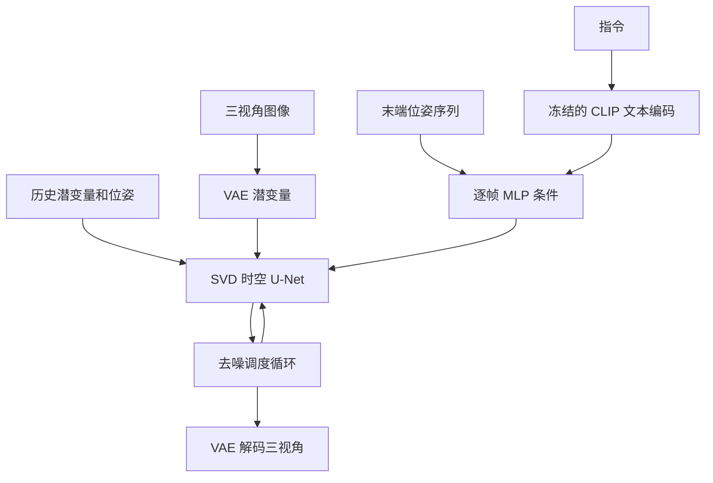

# Ctrl-World：真实尺寸与两轮交互的静态实例

这是写法与验收示例，不是完整模型运行结果。核查于 2026-11-03；论文为
[2510.10125v3](https://arxiv.org/abs/2510.10125v3)，PDF 共 18 页。
代码固定为 [99fb206](https://github.com/Robert-gyj/Ctrl-World/tree/99fb20683fd79dfa6d0c6feb9d49c6c55eecd50d)。
仅阅读官方源码和一条公开 JSON 标注，没有加载权重、训练、运行策略或生成视频。
下面的形状来自配置与调用路径；网络输出数值未知，不用示意激活补齐。

## 原图与额外概括图

论文图 1（PDF 第 2 页）：左侧是策略与世界模型的循环，右侧是轨迹用于评价和改进。
先显示并对照原图，再用下面的概括图突出闭环步骤。原图来自作者项目页；实际使用时，
优先显示本地材料工具裁出的 `fig-01.png`（使用绝对路径）。


先从左侧看：紫色 `Instru` 是任务指令，绿色 `Cam 1–3` 是不同相机的观测，它们供蓝色
`Generalist Policy` 决定动作。沿向下的箭头看，策略输出一段 `N step action chunk`；
这段动作通过虚线连到黄色 `World Model`，由它预测三路 `Pred 1–3` 画面。
再沿上方回路看，预测画面成为策略下一次调用的观测，这才构成连续交互。
下方 `Memory` 指向世界模型，表示模型还利用历史信息，不能把它理解为新拍摄的真实画面。

以“把蓝色积木放到盘子上”为例：策略先输出靠近积木的动作，世界模型预测机械臂移动后
相机能看到什么；策略再据此决定后续动作。这里的箭头主要表示数据传递，不表示机械臂的空间移动。
右侧 `Synthetic Trajectory` 表示把多轮交互串成轨迹，分别用于策略评价和策略改进。
右上小图对照真实环境与模型内的表现，右下柱状示意改进幅度；它们说明作者要验证的用途，
不能仅凭这张总览图就认为生成环境的精细物理已经准确，数值与评价条件还需查看结果章节。


这是依据原文重绘的概括图：P 对应原图 Generalist Policy，W 对应 World Model，H 对应 Memory。
沿 O→P→A→W→H→O 读一轮：当前观测进入策略，动作经适配转成末端位姿，世界模型生成
新的三视角画面，再更新下一轮所需的历史和当前状态。A 是为说明实际代码接口额外展开的步骤，
原总览图没有单独画出这个框。概括图帮助定位闭环主线，具体维度在下面的真实样本中展开。

论文图 2（PDF 第 4 页）：左侧是三视角与位姿条件，中间是稀疏历史和时空网络，
右侧放大逐帧交叉注意力。工具裁图已经检查，关键模块和箭头完整。


先读顶部时间轴：左侧是过去的观测位置，右侧虚线框对应待预测的未来。
中间的 `Sparse History` 和 `Noised Future` 分别表示选入上下文的历史帧与带噪未来帧，
不要把带噪帧当成已观测到的真实未来。左侧三张相机图像编码成空间 token，图中
`P=N×H×W` 说明同一时刻把多个视角的空间位置一起处理；这里 N 表示相机视角数。

接着看中间黄色框：`Spatial Transformer` 处理空间和跨视角关系，`Temporal Transformer`
处理时间关系；这两部分共同参与未来预测。绿色的历史位姿条件与粉色的动作块位姿条件
从左侧进入，右侧放大图展示逐帧对应关系：每帧读取与自己时间位置对应的位姿嵌入。
因此，“先下降、再合爪”的两个条件需要分别对应相应时间位置，而不能仅作为整段视频的模糊指令。
`CLIP Semantic Tokens` 表示图中另一类语义条件，其具体来源须进一步对照实现。

这张图主要解释三件事如何连接：多视角联合输入、历史上下文，以及逐帧位姿条件。
它展示的是结构和信息流，单靠箭头无法证明记忆机制有效；效果仍要看消融实验。
下面的概括图把这些连接映射到当前公开代码使用的 VAE、MLP、U-Net 和调度器。



这是代码路径的概括重绘：MLP 对应原图位姿条件；U-Net 包含原图 spatial / temporal transformer。
从 I→V→U 读视觉路径，再从 A→M→U 读动作条件路径：图像被编码为潜变量，位姿由 MLP
投影为条件嵌入，二者与历史 H 一起参与未来预测。T→C→M 是当前代码的文本条件路径。
U↔S 表示一次预测内部的反复去噪，完成后经 D 解码为可供策略读取的画面；
它与前一张流程图中“策略收到新画面后再次调用”的外部交互循环不同。
与原论文示意的差异也要讲清楚：当前公开路径使用动作嵌入与文本嵌入组合，
`pipeline_ctrl_world.py` L371–375 的 CLIP 图像编码调用已注释，不能仅凭模型初始化就说它在此路径执行。

## 真实样本与入口

使用 [pickplace/annotation/val/0000.json](https://github.com/Robert-gyj/Ctrl-World/blob/99fb20683fd79dfa6d0c6feb9d49c6c55eecd50d/dataset_example/droid_new_setup_full/pickplace/annotation/val/0000.json)。
该公开标注有 88 帧、三路视频，首个指令为 `pick the blue block and place it in plate`。
评估配置实际传入 `pick up the blue block and place in white plate`，不要混为同一字符串。

| 字段 | 实际形状与含义 | 标注首帧真实切片 |
| --- | --- | --- |
| `states` | 每帧 7 维：xyz、欧拉角、夹爪；空间约定来自 FK 代码 | `[0.4632655382, 0.0169253815, 0.4484287798, 3.1247090285, 0.0323393448, 0.0202563482, 0.0]` |
| `joints` | 每帧 8 维：七关节角与夹爪；角度按运动学的弧度约定读取，夹爪字段未在该 JSON 注明物理单位 | `[0.0218160227, -0.2564701140, 0.0159547236, -2.2998697758, -0.0135803530, 2.0107758045, 0.0226384457, 0.0]` |
| `videos` | 三个文件：`videos/val/0000/{0,1,2}.mp4`；代码要求图像 `192×320×3`、uint8 | 本次不下载视频，像素数值未知 |
| 指令 | JSON 字符串；评估入口可覆盖 | 见上述两个真实字符串 |

入口：[rollout_interact_pi_eval.py](https://github.com/Robert-gyj/Ctrl-World/blob/99fb20683fd79dfa6d0c6feb9d49c6c55eecd50d/scripts/rollout_interact_pi_eval.py#L298)，
配置：[config_eval.py](https://github.com/Robert-gyj/Ctrl-World/blob/99fb20683fd79dfa6d0c6feb9d49c6c55eecd50d/config_eval.py#L60)。
下文固定 `task_type=pickplace`：历史 6 帧、每轮预测 5 帧、位姿 7 维、`policy_skip_step=2`、外层交互 15 轮。
论文附录报告历史 7 帧、15 步动作降采样到 5 步；公开默认配置并不完全相同。
其他任务可能覆盖 skip；不能把全部任务都解释为同一时间窗口。

## 模块表

所有推理调用都不执行参数更新。下表“训练更新”指世界模型训练，适配器的独立训练另列；
策略后训练使用另一个流程，不能根据本表推断其冻结规则。

| 模块 | 来源 / 初始化 | 总参数 / 训练参数与依据 | 训练更新 | 实际输入 → 输出 | 设计理由及来源 | 固定版本实现位置 |
| --- | --- | --- | --- | --- | --- | --- |
| 图像预处理与策略接口 | 无参数插值、resize/pad，官方 openpi 的 `pi05_droid` 策略 | 预处理 0；策略精确参数量未核实 | 本路径仅加载策略，无优化器 | 三路图像中取索引 1、2：192×320×3 → 180×320×3 → 224×224×3；关节 7 与夹爪 1 → 动作块 | 作者：兼容现有策略接口 | `rollout_interact_pi_eval.py` L49–61、L227–246 |
| 动作适配器 | 独立学习的 MLP，加载 `model2_15_9.pth` | 374,377，按带偏置 Linear 112→512→512→105 静态精确求和；独立训练时这些参数更新 | 独立训练 MSE；世界模型训练未包含该适配器 | 当前关节 1×7 与速度 15×7 → 预测关节 15×7 | 作者：桥接关节动作与末端位姿 | `models/action_adapter/train2.py` L38–95；评估入口 L76–79、L248–266 |
| FK、限制与抽样 | Panda DH 参数、SciPy 欧拉角变换，无学习参数 | 0 / 0 | 不适用 | 关节 15×7 → 位姿 15×7 → 5×7；附夹爪关节 5×8 | 作者：转换空间；代码：限制 z 与夹爪范围 | `models/utils.py` L7–33；评估入口 L269–295 |
| VAE 编解码 | 预训练 SVD VAE | 总参数未核实 / 0 | 冻结 | 每视角图像 → 4×24×40；三视角沿高度拼成 4×72×40；反向解码 | 作者：在潜空间建模降低计算量 | `models/ctrl_world.py` L117–132；评估入口 L131–145、L189–225 |
| 历史选择与归一化 | 配置索引与数据统计，无学习参数 | 0 / 0 | 不适用 | 6 个历史位姿 + 5 个条件位姿 → 1×11×7；历史潜变量 1×6×4×72×40 | 作者：稀疏历史维持一致性；实现：归一化位姿 | `config_eval.py` L63–88；评估入口 L156–159、L371–376 |
| 动作条件 MLP | 新初始化，7→1024→1024→1024，带偏置 | 2,107,392 / 2,107,392，静态求和，不重复计算共享对象 | 梯度更新 | 1×11×7 → 1×11×1024 | 作者：逐帧动作条件 | `models/ctrl_world.py` L71–107、L142 |
| 文本 tokenizer / CLIP 文本编码器 | `clip-vit-base-patch32` 配置所指检查点 | tokenizer 无学习参数；编码器精确总量未知 / 0 | 冻结，调用有 no_grad | 指令 → 1×512 → 重复为 1×1×1024，与动作嵌入广播相加 | 代码：条件中组合语言信息 | `models/ctrl_world.py` L98–106、L135–139 |
| 时空 U-Net | 从 SVD 权重初始化，改为逐帧条件接口 | 精确总量未知 / 同样未知；论文称基础 SVD 约 1.5B，不能当作这里精确计数 | 梯度更新 | 当前/历史/带噪潜变量与 1×11×1024 条件 → 未来潜变量的去噪预测 | 作者：联合建模多视角与时间关系 | `models/ctrl_world.py` L116–133；`models/pipeline_ctrl_world.py` L470–531 |
| 调度器与输出选择 | SVD 调度器、无参数切片与后处理 | 0 / 0 | 不适用 | 内部默认 50 次去噪，未来潜变量 1×5×4×72×40 → 三视角 3×5×192×320×3 | 代码：迭代去噪、还原像素并更新历史 | `config_eval.py` L58；评估入口 L171–225、L382–385 |

上述本地函数位置均相对固定的 Ctrl-World commit；openpi 内部网络未进一步核查，因此策略内部张量和精确参数量保留未知。
模块理由没有消融支持的部分仅按作者说明或实现作用解释，不据此断言最优。

## 首次调用 i=0：实际尺寸的完整链路

1. 读取样本并编码三视角，图像按 `x/255*2-1` 归一化。VAE 每视角产生 4×24×40；
   拼接首帧成为 `first_latent=(1,4,72,40)`。这里只静态推导形状，潜变量数值未知。
2. 初始化 24 份首帧历史（`num_history*4`），状态与关节历史也重复首值。
   策略输入取初始图像和首帧实际关节状态，两个视角送入 openpi，输出数值未知。
3. 取策略前 15 步：关节速度 15×7、夹爪 15×1。适配器把当前关节 7 与速度 105 个数合成 112 个数，
   MLP 输出 105 个数，reshape 为 15×7 的关节增量，再反归一化并加回当前关节。
4. 代码先前置当前关节，再保留前 15 行；逐行 FK 得 xyz 与欧拉角，附夹爪成为 15×7。
   对 pickplace 的 skip=2，选择行 `[0,2,4,6,8]`，成为 5×7；附夹爪的关节表为 5×8。
   `valid_num=2*(5-1)=8`，附近注释写 12，讲解以表达式实际值为准。
5. 索引 `[0,0,-12,-9,-6,-3]` 选六份历史，拼接五个未来条件得到 11×7；
   归一化加 batch 后为 1×11×7，经 MLP 得 1×11×1024。历史潜变量是 1×6×4×72×40。
6. 当前潜变量、稀疏历史、位姿条件进入视频网络；默认去噪循环 50 次是模型内部循环。
   最终未来潜变量为 1×5×4×72×40，拆三视角并解码为 3×5×192×320×3。
7. 取第 4 号预测帧、关节和位姿追加到历史。图像保留为生成结果，下一轮不能描述成重新拍摄的真实图像。

关键切片来自评估入口 L291–295、L373–384：

```python
state_fk_skip = state_fk[::skip][:self.args.pred_step]
joint_pos_skip = joint_pos[::skip][:self.args.pred_step]
joint_pos_skip = np.concatenate([joint_pos_skip, state_fk_skip[:,-1:]], axis=-1)
```

这三行使用实际 15 行的数组，输出 5 行，不是教学缩小。数组内容依赖未执行的策略与适配器，不能给它们填入假值。

## 后续调用 i=1：明确哪些量更新

| 对象 | i=0 开始 | i=1 开始 |
| --- | --- | --- |
| 当前图像 | 公开样本首帧 | 上轮生成视频的最后一帧，尺寸仍是三路 192×320×3 |
| 当前关节 | JSON 首帧 8 维 | 上轮返回的 `joint_pos[4]`，8 维 |
| 当前末端位姿 | JSON 首帧 7 维 | 上轮 `cartesian_pose[4]`，7 维 |
| 历史缓冲区长度 | 24 | 25，最后一个元素是生成结果 |
| 六个稀疏历史位置 | 全部来自重复首帧 | 对长度 25 的索引为 `[0,0,13,16,19,22]`，此时仍全为初始帧；当前条件另取最新生成帧 |
| 策略和模型权重 | 加载后固定 | 复用，无更新 |
| 动作与视频未来块 | 尚未产生 | 基于新观测重新调用策略、适配器和世界模型；不直接复用旧未来动作块 |

第二轮仍经过策略输入处理 → 15 步适配 → 5 步抽样 → 11 个条件帧 → 视频去噪 → 解码。
结束后历史变为 26，最新状态再次由第二轮生成结果更新。Ground-truth 对照视频的切片从 `[0:5]`
变为 `[4:9]`，它用于比较与保存，并没有替换闭环策略的生成观测。
输出记录选择 `videos_cat[:pred_step-1]`，即前四帧；历史则保留第五帧。
外层按 pickplace 配置运行 15 次后停止；它与每次世界模型内部 50 次去噪不是同一轮次概念。

进度：首次与一次后续调用的静态链路均已走通；未知的是实际策略动作、潜变量、生成像素、运行耗时和成功率。
这些结果需要另行授权并执行模型实验才能验证，不能由源码阅读替代。
