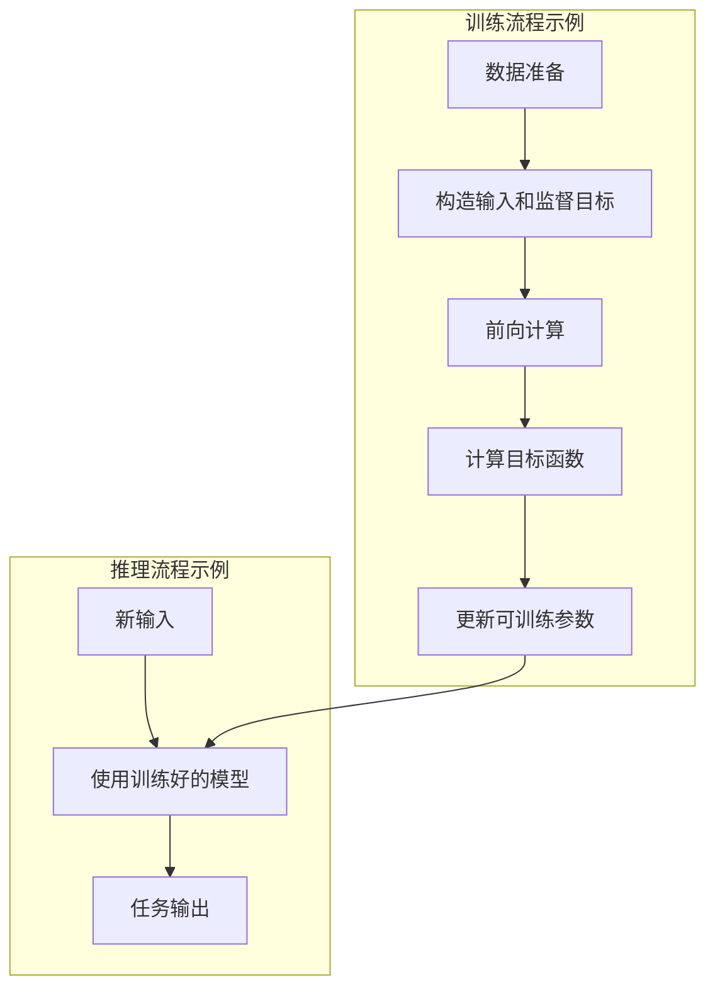
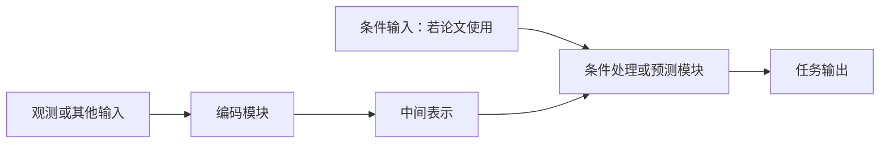

# 11 项讲解结构

按照以下顺序生成完整回答。这里是写作规范，不是需要原样复制的正文。
内容深度服从用户要求；每项都要回答实际问题，减少重复解释。

在第一节之前给出论文标题、作者/机构的必要信息、首次公开日期、所读版本、发表状态，
并链接论文、官方项目页和代码。用一句话概括该方法做了什么。不能确认的信息直接说明。

## 1. 解决的问题

说明研究对象、输入、预期输出，以及已有方法在哪个具体条件下失败或成本过高。
区分论文的问题定义与作者选择的技术路线：例如“需要预测动作后果”是问题，
“用潜在特征而非像素预测”是方法选择。

给出主要基线或前序工作的差距；不要把所有现有方法一概描述为无法工作。
若用户已有系统，明确该论文与用户瓶颈的关系。

## 2. 流程图

给出按时间或操作顺序展开的 Mermaid 图。训练和推理不同则分别放入子图，
标清数据、目标、模型更新和推理输出之间的关系；闭环系统标出执行后重新观测。

下图仅演示图的语法和层次，使用时必须根据所读论文改写，不假设每篇论文都有训练或闭环：

图后解释最关键的数据流和训练/推理差别，并注明依据的原文章节或图。
重绘不应偷偷加入论文未使用的模块。

## 3. 框架图

给出模块连接图，强调编码、融合、预测、解码、损失、规划之间的结构。
注明哪些模块共享参数、冻结或训练，哪些只在训练或可视化时使用；仅标注已经核实的属性。

以下同样只是语法示例，不能作为通用的论文事实：

对多相机模型，要展示每个视角在哪里编码、在哪里交互，输出是每视角结果还是统一表示。
训练和推理共用模块可画在同一图中，但监督目标与推理输入的箭头必须可区分。

## 4. 解决问题的方法

按机制拆解，不必照论文小节逐段翻译：

- 数据如何组织，样本、时序和条件如何配对。
- 输入如何转为表示，哪些信息被保留或舍弃。
- 模块如何融合信息并产生预测，监督信号与损失是什么。
- 推理如何使用预测，是否需要搜索、采样、迭代、反馈或额外模型。

对重要设计说明“为什么这样做”“证据来自哪里”“付出什么代价”。
模型学习的对象与系统计算/积分得到的对象要分开。例如不能把命令积分得到的状态说成学习到的状态动力学。
公式、维度、预测步长和时序对齐只有在解释机制时才展开。

## 5. 核心

用一句话提炼决定方法成立的关键思想，再用必要的短段解释。
指出它依赖的前提：表示质量、动作可辨识性、同步数据、目标可度量性等，应按实际论文选择。
可以用“去掉这个机制会损失什么”帮助理解，但没有消融时只能作为机制推断。

## 6. 没有解决的部分

分清作者明确承认的局限，以及根据实验范围推断的证据缺口。
没有测试不等于已经失败；整体指标好也不代表鲁棒性、泛化、实时性和部署成本都得到验证。

根据论文选择有意义的问题，如分布变化、遮挡、长期误差、接触细节、动作空间、
相机布局变化、不确定性或推理延迟。不要用一份通用缺点清单替代阅读。

## 7. 启发、可以做的点与数据集

围绕用户目标提出可检验的研究方向，明确这是建议。
每个方向应包含：

- 尚未解决的具体问题与工作假设。
- 相对论文的改动位置，以及与已有能力的区别。
- 能证实或否定假设的基线、消融和指标。
- 所需数据、可用数据集及字段、采集或补齐的代价。

数据集用官方来源核查动作、状态、多视角、时间同步、标定和失败轨迹等所需字段。
区分“论文实际使用”和“推荐用于后续实验”，有数据集名称不等于数据可下载或可直接训练。
若原论文已有多相机输入，不把“加入第二路相机”本身包装成新的研究贡献。
若没有做相关工作检索，称为候选方向，不能宣称首创。

## 8. 官方代码

给出官方仓库与核查日期，尽量记录所看的分支、tag 或 commit。
按实际情况报告训练、推理、评估、权重、数据处理、规划/部署、关键配置和许可证。
使用文件或配置链接帮助用户定位最值得借鉴的实现。

明确区分完整训练实现、推理实现、部分模块、仅权重和占位仓库。
论文能力与公开版本不一致时同时说明；未找到官方代码时写清查找范围，第三方实现另列。
仓库“有文件”只证明发布了该内容，未经运行不能说代码已验证可复现。

## 9. 复现难度

按用户需要讨论下列适用层级，可用表格对比：

| 复现层级 | 要核查的条件 | 判断依据 |
| --- | --- | --- |
| 现成权重推理 | 权重、依赖、输入格式、许可证 | 官方入口与可用资产 |
| 小规模训练/微调 | 数据转换、配置、冻结模块、算力 | 已公开配置与数据子集 |
| 论文主要结果 | 完整数据混合、训练配方、评估协议 | 缺失环节和原实验资源 |
| 实际系统部署 | 硬件接口、动作语义、延迟和校准 | 闭环实验与部署代码 |

定性评估容易/中等/困难时，解释主要瓶颈。
列出已测硬件或官方配置，但不要据此编造最低显存与训练时间。
给出最小验证路径及通过标准，如先核对输入与预测，再做小数据训练，最后闭环测试。
资源或数据缺失时明确其影响，而不是笼统地说“有开源所以容易”。

## 10. 创新点

将贡献与最接近的前序工作对照，分别说明方法、训练方式、系统组合、数据或规模实验的新意。
解释已有组件怎样组合、这种组合解决了什么；不要把采用某种常见网络本身当作创新。

每个主要创新给出证据与边界：直接消融、组合实验、规模趋势或仅作者论证。
扩展性结论限定于实验模型、数据、表示和计算区间；拟合关系不能自动推广到新设置。
参数量要说明统计范围，避免只报告预测器却让读者误以为包含整个系统。

## 11. 问题的场景

用具体任务说明：系统看见什么、知道什么、可控制什么、要达到什么目标、
模型在何时介入，以及成功和失败分别怎样表现。

优先选用论文实际验证过的任务，并说明仿真还是真实系统。
为帮助理解而构造的情境应标为示例；不要把它说成论文实验。
点明适用场景和超出证据范围的场景，让读者能判断自己的任务是否匹配。

引用可以直接放在相关段落或表格中，也可以在末尾附紧凑的来源清单。
正文中的重要事实应能追溯到具体来源，不能只有末尾的一串链接。
