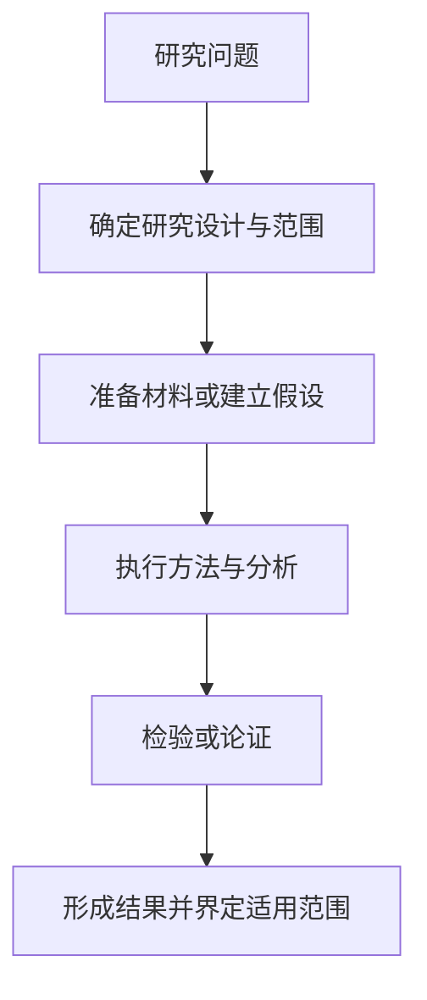
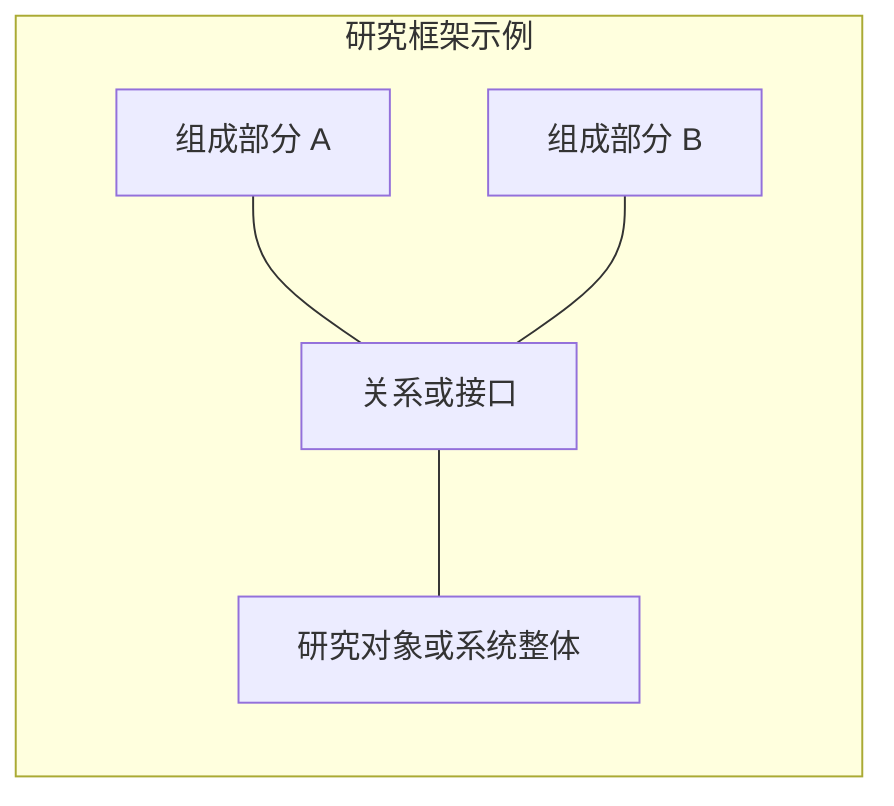

# 11 项讲解结构

按照以下顺序生成完整回答。这里是写作规范，不是需要原样复制的正文。
内容深度服从用户要求；每项都要回答实际问题，减少重复解释。

在第一节之前给出论文标题、作者/机构的必要信息、首次公开日期、所读版本、发表状态，
并链接论文及已核实的官方补充材料。说明研究类型，用一句话概括主要贡献。不能确认的信息直接说明。

## 1. 解决的问题

说明研究对象、问题的重要性、已有认识的缺口，以及论文试图回答的具体问题。
算法或系统论文可说明输入输出；其他论文可说明研究假设、待证命题、解释对象或综合范围。
区分问题本身与作者选择的研究方法，不预设已有工作都失败或必须由某一种方法解决。

给出主要基线或前序工作的差距；不要把所有现有方法一概描述为无法工作。
若用户明确提供研究目标，说明该论文与其问题的关系；否则围绕论文自身展开。

## 2. 流程图

给出按时间、操作或论证顺序展开的 Mermaid 图，按论文选择：

- 算法与系统：数据处理、算法执行、测试或运行流程；训练和推理不同时可分开。
- 实验与观察研究：取样、分组、干预或观测、测量、分析与验证。
- 理论研究：定义与假设、关键引理、主要定理及推论的证明路线。
- 定性研究：材料获取、编码或其他分析过程、解释与验证。
- 综述：检索、筛选、质量评价与证据综合；只画作者实际报告的步骤。

下图只演示研究过程的语法，使用时必须根据论文改写，不假设每篇论文都有数据或实验：

图后解释关键步骤和阶段间关系，并注明依据的原文章节或图。
不能将建议的验证步骤画成作者已经执行的研究过程。

## 3. 框架图

给出结构关系图，与上一节的过程图保持不同用途。
算法论文展示模块与接口；实证论文展示研究变量、分组和测量关系；理论论文展示定义与命题依赖；
定性论文展示概念或主题之间的关系；综述可展示作者的分类框架。
区分已证实关系、研究假设和分析者的概括，不把相关关系画成确定因果。

以下同样只是语法示例，不能作为通用的论文事实：

模块、变量或概念名称来自论文；箭头、连线和子图的含义应清楚说明。
没有工程架构时，用概念结构或论证依赖图满足这一项，不凭空添加技术模块。

## 4. 解决问题的方法

按机制拆解，不必照论文小节逐段翻译：

- 研究材料、数据、样本或数学对象如何选择和定义。
- 关键假设、研究设计和分析或推导步骤是什么。
- 方法怎样产生结果，各关键步骤承担什么作用。
- 结果如何验证，采用什么对照、基线、证明、稳健性检查或解释依据。

对重要设计说明“为什么这样做”“证据来自哪里”“付出什么代价”。
区分方法直接得到的结果与进一步的解释或推论；不要用摘要术语替代机制说明。
公式、参数、实验操作或推导细节只有在解释机制时才展开，并说明符号与成立条件。

## 5. 核心

用一句话提炼决定方法成立的关键思想，再用必要的短段解释。
指出核心结论依赖的前提，例如样本代表性、测量有效性、识别假设、数学条件或系统约束，按论文选择。
可以用“缺少这个机制或条件会怎样”帮助理解，但没有直接证据时应标为推断。

## 6. 没有解决的部分

分清作者明确承认的局限，以及根据实验范围推断的证据缺口。
没有研究不等于已经失败；局部结果也不等于外部有效性、普遍性或实际价值已经得到验证。

根据论文选择有意义的限制，如样本与数据范围、测量偏差、混杂、假设强度、
未覆盖情境、可扩展性或成本。不要用一份通用缺点清单替代阅读。

## 7. 启发、可以做的点与数据集

围绕论文的证据缺口提出可检验的研究方向；用户明确给出研究目标时再与之联系，明确这是建议。
每个方向应包含：

- 尚未解决的具体问题与工作假设。
- 相对论文需要改变的方法、条件或研究范围，以及与已有贡献的区别。
- 能证实或否定假设的实验、对照、分析、证明或反例。
- 所需数据、样本、材料、验证用例或其他资源，以及获取或补齐的代价。

涉及数据集时，用官方来源核查数据定义、覆盖范围、必要字段、许可与访问条件。
区分“论文实际使用”和“推荐用于后续研究”，有名称不等于数据可获取或适合当前问题。
不涉及数据集的论文可以讨论材料来源、理论用例、反例或研究设计，不强行推荐数据集。
不能把论文已经具备的能力或已有结论重新包装成新的研究贡献。
若没有做相关工作检索，称为候选方向，不能宣称首创。

## 8. 官方代码

给出官方仓库与核查日期，尽量记录所看的分支、tag 或 commit。
按论文实际情况报告实现、分析脚本、模型、数据处理、数值实验、证明助手代码、配置和许可证。
使用文件或配置链接帮助用户定位最值得借鉴的实现。

明确区分完整研究实现、部分模块、仅推理或分析、仅模型文件和占位仓库。
论文能力与公开版本不一致时同时说明；未找到官方代码时写清查找范围，第三方实现另列。
仓库“有文件”只证明发布了该内容，未经运行不能说代码已验证可复现。
论文不涉及代码时说明“不适用”，并指出有无实验协议、附录、材料目录等其他公开资源。
代码不是所有研究的必要交付，不能仅因没有仓库就否定结论。

## 9. 复现难度

按用户需要讨论下列适用层级，可用表格对比：

| 复现层级 | 要核查的条件 | 判断依据 |
| --- | --- | --- |
| 理解性验证 | 最小示例、推导检查或小规模实验 | 方法是否可执行、假设是否清楚 |
| 复算公开结果 | 数据、代码、配置、分析流程或证明材料 | 是否具备重建关键结果的材料 |
| 独立重复研究 | 新样本、完整协议、设备、权限或独立实现 | 是否能在相同或明确变更的条件下重做研究 |
| 实际应用或扩展 | 外部场景、系统接口、资源与适用条件 | 研究结论与实际需求之间的差距 |

定性评估容易/中等/困难时，解释主要瓶颈。
按研究类型列出必要的计算、数据、设备、样本、权限或专业条件，不编造最低成本与耗时。
给出最小验证路径及通过标准，区分复算相同结果、独立重复与推广验证。
资源或数据缺失时明确其影响，而不是笼统地说“有开源所以容易”。

## 10. 创新点

将贡献与最接近的前序工作对照，按论文解释问题、理论、方法、证据、资源、系统或综合框架的新意。
说明哪些是已有要素、哪些是新的组合或结论，以及它们实际解决了什么。

每个主要创新给出证据与边界：对照研究、分解分析、理论证明、独立验证或仅作者论述。
经验结论限定于实际研究范围，拟合关系不能自动推广；理论结论保留其假设与量词。
规模、成本和效率比较要说明统计口径，不能用局部开销代表全部研究或系统成本。

## 11. 问题的场景

用一个具体问题说明：研究对象处于什么条件、已有信息是什么、需要回答或完成什么，
论文的方法或结论如何介入，以及什么结果能体现它的价值或边界。

优先选用论文实际研究的案例、实验情境或理论对象，说明其性质和前提。
为帮助理解而构造的情境应标为示例，不能冒充论文证据。
基础理论或描述性研究可以展示解释用例或边界案例，不强行编造应用部署场景。

引用可以直接放在相关段落或表格中，也可以在末尾附紧凑的来源清单。
正文中的重要事实应能追溯到具体来源，不能只有末尾的一串链接。
